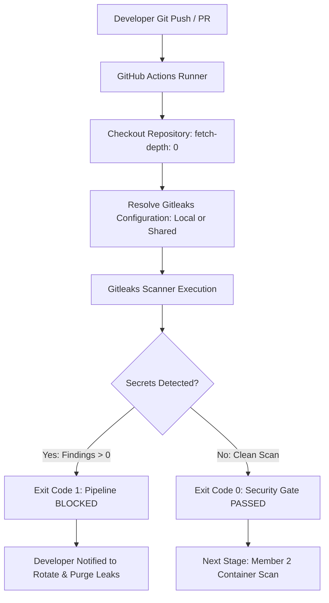

# Automated Local DevSecOps — Secret Scanner & Image Guard

## Module: Member 1 — Secret Security Gate (Gitleaks)

[](https://github.com/gitleaks/gitleaks)
[]()
[]()

---

## 1. Project Overview & Problem Statement

### 1.1 Overview
In modern cloud-native development, sensitive credentials—such as database passwords, third-party API tokens, cloud provider keys, and private certificates—are frequently checked into source code repositories by accident. Even if quickly deleted in a subsequent commit, **unencrypted credentials persist in Git commit history permanently**, exposing infrastructure and customer data to severe breaches.

This repository implements the **Secret Security Gate** (Member 1) of the team project: **Automated Local DevSecOps — Secret Scanner & Image Guard**. It combines a robust local scanning setup using [Gitleaks](https://github.com/gitleaks/gitleaks) with a centralized, **reusable GitHub Actions security workflow** that can be consumed by external repositories across our organization.

### 1.2 The First Security Gate
The Gitleaks workflow acts as the **first defensive gate** in the end-to-end DevSecOps pipeline. By intercepting code on every push and pull request before containerization or deployment, it guarantees that no hardcoded credentials make their way downstream to image builders or orchestrators.

---

## 2. Team Architecture & Responsibilities

The overall DevSecOps project is partitioned across four specialized engineering modules:

| Member | Focus Area | Technologies | Scope / Status in This Repository |
| :--- | :--- | :--- | :--- |
| **Member 1 (This Module)** | **Secret Detection Gate** | **Gitleaks (CLI & Action), Git, GitHub Actions** | **Implemented:** Local rules, full-history scanning, and reusable GitHub Actions workflow. |
| **Member 2** | Container Image Security | Docker, Trivy | *Downstream module:* Vulnerability scanning for container base images and application dependencies. |
| **Member 3** | Kubernetes Cluster Security | Minikube, Kyverno | *Downstream module:* Admission controller policies, pod security standards, and runtime verification. |
| **Member 4** | CI/CD Orchestration & Alerts | GitHub Actions, Slack / Discord Webhooks | *Downstream module:* End-to-end pipeline coordination, multi-stage gating, and team notifications. |

> [!NOTE]
> Member 1 provides the foundational Secret Detection Gate. Docker, Trivy image scanning, Kubernetes/Kyverno admission controllers, and messaging alerts belong to Members 2, 3, and 4 respectively and are not implemented inside this repository.

---

## 3. Architecture & Security Flow



### Flow Breakdown:
1. **Trigger:** A developer commits code and pushes to `main` or opens a Pull Request targeting `main`.
2. **Checkout:** GitHub Actions checks out the repository with `fetch-depth: 0` to preserve the complete commit history for retrospective analysis.
3. **Configuration Resolution:** The runner checks for caller-specific `.gitleaks.toml` rules. If absent, it securely fetches the central configuration from `Akansha1425/automated-local-devsecops`.
4. **Scan:** Gitleaks scans the commit diffs and history against built-in signatures plus custom team rules.
5. **Enforcement:**
   - **Exit Code 0:** Clean repository. The gate passes and downstream pipelines proceed.
   - **Exit Code 1:** Secret detected. The workflow halts immediately, blocking pull request merges or deployments.

---

## 4. Repository Structure

```text
gitleaks/
├── .github/
│   └── workflows/
│       ├── reusable-gitleaks.yml   # Centralized reusable workflow for any repo
│       └── secret-scan.yml         # Local caller workflow for this repository
├── .gitignore                      # Excludes binaries, artifacts, and real secret files
├── docs/
│   └── secret-scanning.md          # Extended technical and configuration guide
├── gitleaks/
│   ├── .gitleaks.toml              # Detection rules (default rules + 3 custom rules)
│   └── README.md                   # Module-specific documentation
├── gitleaks_install/               # Local Windows binary extraction (git-ignored)
│   ├── gitleaks.exe                # Local test binary (v8.21.2)
│   ├── gitleaks.zip                # Installation archive
│   ├── LICENSE                     # Upstream license
│   └── README.md                   # Upstream documentation
├── test-secrets/                   # Demo fixtures
│   ├── bad.env                     # Intentionally fake credentials (FAIL test fixture)
│   └── clean.env                   # Harmless configuration (PASS test fixture)
└── README.md                       # Root documentation (this file)
```

---

## 5. Technologies Used

- **Gitleaks CLI (v8.21.2):** Fast, standalone static analysis tool for detecting secrets in Git repositories.
- **Gitleaks Action (`gitleaks/gitleaks-action@v2`):** Official GitHub Action for running Gitleaks in CI/CD pipelines.
- **GitHub Actions Reusable Workflows (`workflow_call`):** Enables centralized management of security scans across multiple repositories.
- **Windows PowerShell:** Local development, execution, and validation environment.
- **TOML:** Configuration format for custom regular expression rules and allowlists.

---

## 6. Local Installation & Testing (Windows PowerShell)

### 6.1 Prerequisites
- Windows 10/11 with PowerShell 5.1+ or PowerShell 7+
- Git installed and initialized (`git --version`)

### 6.2 Verifying Local Installation
The repository includes an untracked local installation directory (`gitleaks_install/`) containing Gitleaks v8.21.2 for testing without modifying system environment variables.

Run from the project root:

```powershell
# Check Gitleaks version
.\gitleaks_install\gitleaks.exe version
# Expected output: 8.21.2
```

### 6.3 Test 1: Clean File Scan (Expected: PASS, Exit Code 0)
To verify that harmless configuration values pass without false positives, scan the clean test fixture:

```powershell
.\gitleaks_install\gitleaks.exe dir --config gitleaks/.gitleaks.toml --verbose test-secrets/clean.env
echo "Exit Code: $LASTEXITCODE"
```

**Observed Result:**
```text
INF scan completed in 3.13ms
INF no leaks found
Exit Code: 0
```

### 6.4 Test 2: Fake Secret Detection (Expected: FAIL, Exit Code 1)
To verify that custom detection rules correctly intercept leaked credentials:

```powershell
.\gitleaks_install\gitleaks.exe dir --config gitleaks/.gitleaks.toml --verbose test-secrets/bad.env
echo "Exit Code: $LASTEXITCODE"
```

**Observed Detections:**
1. `DATABASE_PASSWORD="mysecret123"` &rarr; Rule `generic-password-assignment`
2. `API_KEY="FAKE_API_KEY_123456"` &rarr; Rule `generic-api-key-assignment`
3. `ACCESS_TOKEN="superSecretToken_Demo_NotReal_9999"` &rarr; Rule `generic-api-key-assignment`

```text
WRN leaks found: 3
Exit Code: 1
```

### 6.5 Test 3: Full Git History Scan
To scan all commits across the repository:

```powershell
.\gitleaks_install\gitleaks.exe git --config gitleaks/.gitleaks.toml --verbose
echo "Exit Code: $LASTEXITCODE"
```

> [!WARNING]
> **Important Note on Git History:** Because `test-secrets/bad.env` was committed in historical commit `1c5e958`, a full-history scan of this repository will detect those 3 fake secrets and exit with code `1`. This is the intended behavior of a secret gate and confirms that Gitleaks cannot be bypassed simply by deleting a file in a later commit.

---

## 7. GitHub Actions Workflows

We provide two workflows located under `.github/workflows/`:
1. `reusable-gitleaks.yml`: The shared, reusable workflow that external projects call.
2. `secret-scan.yml`: The local caller workflow that enforces scanning on this repository.

### 7.1 Reusable Workflow (`.github/workflows/reusable-gitleaks.yml`)

This workflow runs on `ubuntu-latest`, checks out the caller's repository, resolves the ruleset, and runs Gitleaks:

```yaml
name: "Reusable Gitleaks Secret Scan"

on:
  workflow_call:
    inputs:
      config-path:
        description: "Path to custom Gitleaks configuration in caller repo (default: auto-detects or downloads shared config)"
        required: false
        type: string
        default: ""
      config-ref:
        description: "Branch/tag/commit in Akansha1425/automated-local-devsecops for shared config fallback"
        required: false
        type: string
        default: "main"
      fetch-depth:
        description: "Commits to fetch (0 = full history, 1 = shallow clone)"
        required: false
        type: number
        default: 0
      gitleaks-version:
        description: "Gitleaks binary version (default: '8.21.2')"
        required: false
        type: string
        default: "8.21.2"
      fail-on-leak:
        description: "Fail the job if leaks are detected (default: true)"
        required: false
        type: boolean
        default: true
    secrets:
      GITLEAKS_LICENSE:
        description: "Optional Gitleaks license key (only needed for GitHub Organization accounts)"
        required: false

permissions:
  contents: read

jobs:
  scan:
    name: "Gitleaks Secret Scan"
    runs-on: ubuntu-latest
    permissions:
      contents: read
    steps:
      - name: "Checkout calling repository"
        uses: actions/checkout@v4
        with:
          fetch-depth: ${{ inputs.fetch-depth }}

      - name: "Resolve Gitleaks configuration"
        id: resolve-config
        shell: bash
        run: |
          set -euo pipefail
          INPUT_CONFIG="${{ inputs.config-path }}"
          if [ -n "$INPUT_CONFIG" ]; then
            if [ -f "$INPUT_CONFIG" ]; then
              echo "config_path=$INPUT_CONFIG" >> "$GITHUB_OUTPUT"
            else
              echo "::error::Specified config-path '$INPUT_CONFIG' was not found."
              exit 1
            fi
          elif [ -f "gitleaks/.gitleaks.toml" ]; then
            echo "config_path=gitleaks/.gitleaks.toml" >> "$GITHUB_OUTPUT"
          elif [ -f ".gitleaks.toml" ]; then
            echo "config_path=.gitleaks.toml" >> "$GITHUB_OUTPUT"
          else
            CONFIG_URL="https://raw.githubusercontent.com/Akansha1425/automated-local-devsecops/${{ inputs.config-ref }}/gitleaks/.gitleaks.toml"
            mkdir -p .gitleaks-shared
            HTTP_STATUS=$(curl -sSL -w "%{http_code}" -o .gitleaks-shared/.gitleaks.toml "$CONFIG_URL")
            if [ "$HTTP_STATUS" -ne 200 ] || [ ! -s .gitleaks-shared/.gitleaks.toml ]; then
              echo "::error::Failed to download valid shared configuration from $CONFIG_URL"
              exit 1
            fi
            echo "config_path=.gitleaks-shared/.gitleaks.toml" >> "$GITHUB_OUTPUT"
          fi

      - name: "Run Gitleaks secret detection"
        uses: gitleaks/gitleaks-action@v2
        continue-on-error: ${{ !inputs.fail-on-leak }}
        env:
          GITHUB_TOKEN: ${{ secrets.GITHUB_TOKEN }}
          GITLEAKS_LICENSE: ${{ secrets.GITLEAKS_LICENSE }}
          GITLEAKS_CONFIG: ${{ steps.resolve-config.outputs.config_path }}
          GITLEAKS_VERSION: ${{ inputs.gitleaks-version }}
          GITLEAKS_ENABLE_COMMENTS: "false"
          GITLEAKS_ENABLE_UPLOAD_ARTIFACT: "false"
          GITLEAKS_ENABLE_SUMMARY: "true"
```

### 7.2 Caller Workflow (`.github/workflows/secret-scan.yml`)

The caller workflow triggers on every push and PR to `main`:

```yaml
name: "Secret Scan Gate"

on:
  push:
    branches: [main]
  pull_request:
    branches: [main]
  workflow_dispatch:

permissions:
  contents: read

jobs:
  secret-scan:
    name: "Run Reusable Gitleaks Security Gate"
    uses: ./.github/workflows/reusable-gitleaks.yml
    permissions:
      contents: read
    with:
      config-path: "gitleaks/.gitleaks.toml"
      fetch-depth: 0
      gitleaks-version: "8.21.2"
      fail-on-leak: true
    secrets: inherit
```

---

## 8. Integration Guide for Other Developers

Other developers working on microservices, backend APIs, or web applications can integrate this security gate in under 2 minutes.

> [!IMPORTANT]
> Merely hosting this repository does not automatically protect external projects. Developers **must explicitly create a caller workflow** in their own repositories.

### Step 1: Create Workflow File in the Calling Repository
In your project repository, create `.github/workflows/secret-scan.yml`:

```yaml
name: Secret Security Gate

on:
  push:
    branches: [main]
  pull_request:
    branches: [main]
  workflow_dispatch:

permissions:
  contents: read

jobs:
  gitleaks:
    name: Secret Scanner
    uses: Akansha1425/automated-local-devsecops/.github/workflows/reusable-gitleaks.yml@main
    permissions:
      contents: read
    with:
      fetch-depth: 0
    secrets: inherit
```

### Step 2: Shared Rules & Configuration Resolution
The reusable workflow automatically resolves rules in the following priority order:
1. `config-path` input (if explicitly specified by caller).
2. Local `gitleaks/.gitleaks.toml` or `.gitleaks.toml` inside the caller repository.
3. Fallback: Automatically downloads the team's standard `.gitleaks.toml` from `Akansha1425/automated-local-devsecops` at branch `main` (or a pinned commit/tag via `config-ref`).

### Step 3: Pinning Versions for Production Stability
For immutable, reproducible enterprise deployments, pin the workflow and config reference to a specific commit SHA or release tag:

```yaml
uses: Akansha1425/automated-local-devsecops/.github/workflows/reusable-gitleaks.yml@v1.0.0
with:
  config-ref: "v1.0.0"
```

---

## 9. Understanding Workflow Results & Troubleshooting

### 9.1 Interpreting Scan Results
- **Job Green (Passed &check;):** Zero secrets detected in git history or committed files.
- **Job Red (Failed &cross;):** Gitleaks detected one or more hardcoded secrets. Review the GitHub Actions **Job Summary** or step logs.

### 9.2 Privacy & Secret Exposure Prevention
To prevent accidental leakage of real secrets within CI/CD artifacts or public discussions:
- PR comments are **disabled** (`GITLEAKS_ENABLE_COMMENTS: "false"`).
- Artifact uploads of raw SARIF leak reports are **disabled** (`GITLEAKS_ENABLE_UPLOAD_ARTIFACT: "false"`).
- Findings are summarized inside the runner's secure **Job Summary**.

### 9.3 Troubleshooting Matrix

| Problem / Error | Cause | Resolution |
| :--- | :--- | :--- |
| `gitleaks: command not found` (Local) | Binary not installed on PATH | Use `.\gitleaks_install\gitleaks.exe` or install via `winget install gitleaks`. |
| `workflow does not exist on main` | Workflow not yet pushed to the referenced branch | Commit and push `.github/workflows/reusable-gitleaks.yml` to `main` before referencing `@main`. |
| `Failed to download shared Gitleaks configuration (HTTP 404)` | Upstream repository is private or branch name is wrong | Verify the repository is public or update `config-ref` to an existing branch/tag. |
| `Gitleaks license required` | Caller is a GitHub Organization account | Obtain a free or team license from [gitleaks.io](https://gitleaks.io) and set the secret `GITLEAKS_LICENSE`. Personal accounts do not need this. |
| Historical test secrets fail CI | Intentionally fake credentials exist in Git history | Expected for test repositories with committed fixtures. Real projects should rotate and purge secrets using `git filter-repo` or BFG Repo-Cleaner. |

---

## 10. Security Best Practices

1. **Never Commit Real Secrets:** Treat `.env`, `*.key`, `*.pem`, and `*.secret` as non-committable assets. Use `.gitignore` to prevent accidental staging.
2. **Immediate Credential Rotation:** If a secret is ever pushed to a remote repository, consider it **compromised immediately**. Deleting the line or commit does not protect you; rotate the key at the provider immediately.
3. **Defense in Depth:** Combine pre-commit hooks (local defense) with GitHub Actions (centralized enforcement) so secrets are caught before leaving the developer workstation.
4. **Least Privilege CI Permissions:** Workflows running secret scans only need `contents: read`. Never grant `write` access unless PR commenting is strictly required.

---

## 11. Git Version Control & Working Tree

Current Git state:
- Branch: `main`
- Remote: `https://github.com/Akansha1425/automated-local-devsecops.git`
- Module: Member 1 (Secret Security Gate)
