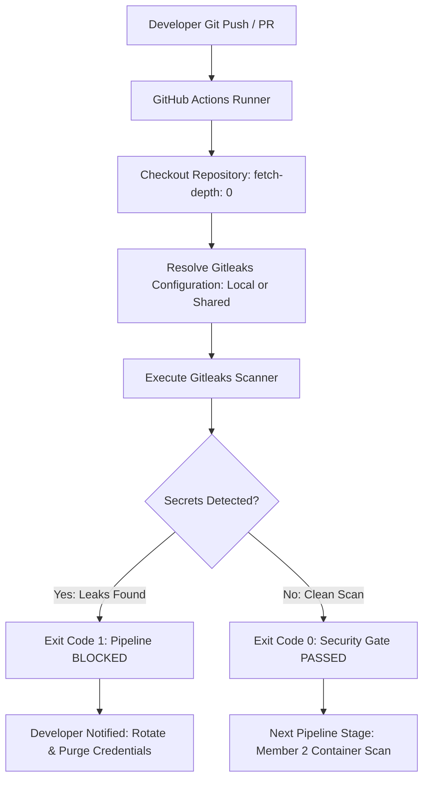

# Automated Local DevSecOps — Secret Scanner & Image Guard

## Part 1: Member 1 — Secret Security Gate (Gitleaks)

[](https://github.com/gitleaks/gitleaks)
[](https://github.com/Akansha1425/automated-local-devsecops)
[]()

---

## 1. Project Overview & Part 1 Scope

### 1.1 What is this Project?
**Automated Local DevSecOps — Secret Scanner & Image Guard** is an automated security pipeline designed to enforce security controls at every stage of the software delivery lifecycle.

This repository contains **Part 1 (Member 1: Secret Detection Gate)**. It provides automated detection of hardcoded secrets, API keys, database credentials, and access tokens before code can be deployed or containerized.

### 1.2 The First Security Gate
Accidentally committing credentials to a Git repository is dangerous because **Git retains deleted items in commit history forever**. 

The Gitleaks Secret Detection Gate serves as the **very first defense boundary** in our DevSecOps workflow:
- Scans files before commit (local CLI & pre-commit hook)
- Scans every push and pull request (automated GitHub Actions workflow)
- Scans complete Git commit history to ensure past commits are clean
- Blocks the pipeline with **Exit Code 1** if secrets are detected
- Passes with **Exit Code 0** when code is safe

---

## 2. Team Architecture & Responsibilities

The DevSecOps project is divided across four specialized member modules:

| Member | Module Focus | Core Tools | Status in this Repo |
| :--- | :--- | :--- | :--- |
| **Member 1 (This Repository)** | **Secret Security Gate** | **Gitleaks CLI (v8.21.2), Git, GitHub Actions** | **Implemented & Active** |
| **Member 2** | Container Image Security | Docker, Trivy | Downstream module (vulnerability scanning for images) |
| **Member 3** | Kubernetes Security | Minikube, Kyverno | Downstream module (cluster admission policies) |
| **Member 4** | CI/CD Pipeline & Alerts | GitHub Actions, Slack / Discord Webhooks | Downstream module (orchestration & alert dispatch) |

> [!NOTE]
> Member 1 delivers the secret detection gate. Docker/Trivy, Kubernetes/Kyverno, and webhook notification scripts belong to Members 2, 3, and 4 and are maintained in their respective stages.

---

## 3. Security Flow Architecture



---

## 4. Repository Structure

```text
gitleaks/
├── .github/
│   └── workflows/
│       ├── reusable-gitleaks.yml   # Reusable GitHub Actions workflow for any repo
│       └── secret-scan.yml         # Local caller workflow for this repository
├── .gitignore                      # Excludes binaries, artifacts, and real secret files
├── docs/
│   └── secret-scanning.md          # Extended technical and configuration guide
├── gitleaks/
│   ├── .gitleaks.toml              # Central detection rules (default + 3 custom rules)
│   └── README.md                   # Module-specific documentation
├── gitleaks_install/               # Local Windows binary extraction (git-ignored)
│   ├── gitleaks.exe                # Gitleaks binary v8.21.2
│   ├── gitleaks.zip                # Upstream zip archive
│   ├── LICENSE                     # License file
│   └── README.md                   # Upstream Gitleaks docs
├── test-secrets/                   # Safe test fixtures
│   ├── bad.env                     # Intentionally fake credentials (FAIL test fixture)
│   └── clean.env                   # Harmless configuration (PASS test fixture)
└── README.md                       # Root documentation (this file)
```

---

## 5. Detection Rules & Test Fixtures

### 5.1 Rules Configuration (`gitleaks/.gitleaks.toml`)
- **Built-in Rules:** `[extend] useDefault = true` loads 200+ signatures (AWS access keys, GitHub tokens, JWTs, GCP credentials, private keys, Slack tokens).
- **Custom Rule 1 (`generic-password-assignment`):** Catches variables matching `password = "..."`, `passwd = "..."`, or `pwd = "..."` with entropy checks.
- **Custom Rule 2 (`generic-api-key-assignment`):** Catches variables matching `api_key = "..."`, `api_token = "..."`, or `access_token = "..."`.
- **Custom Rule 3 (`aws-secret-key-assignment`):** Catches `aws_secret_access_key = "..."` patterns.

### 5.2 Test Fixtures
1. **`test-secrets/clean.env` (Safe Demo File):**
   Contains non-sensitive keys (`DATABASE_HOST`, `DATABASE_PORT`, `LOG_LEVEL`, `ENABLE_DEBUG`). Produces **0 leaks** and returns **Exit Code 0 (PASS)**.
2. **`test-secrets/bad.env` (Fake Leaks Demo File):**
   Contains intentionally fake mock credentials (`DATABASE_PASSWORD`, `API_KEY`, `ACCESS_TOKEN`). Triggers custom rules, produces **3 detections**, and returns **Exit Code 1 (FAIL)**.

---

## 6. Exact Commands to Run (Windows PowerShell)

All commands below should be executed from the repository root:
`C:\Users\nikit\OneDrive\Pictures\Documents\gitleaks`

### 6.1 Check Gitleaks Version
Verify that the local binary is present and working:

```powershell
.\gitleaks_install\gitleaks.exe version
```
*Expected Output:*
```text
8.21.2
```

---

### 6.2 Run Clean Test Scan (PASS &check;)
Scan the safe configuration file to confirm zero false positives:

```powershell
.\gitleaks_install\gitleaks.exe dir --config gitleaks/.gitleaks.toml --verbose test-secrets/clean.env
echo "Exit Code: $LASTEXITCODE"
```
*Expected Output:*
```text
INF scan completed in 3.13ms
INF no leaks found
Exit Code: 0
```

---

### 6.3 Run Fake Secret Test Scan (FAIL &cross;)
Scan the fixture with fake credentials to verify that detections trigger:

```powershell
.\gitleaks_install\gitleaks.exe dir --config gitleaks/.gitleaks.toml --verbose test-secrets/bad.env
echo "Exit Code: $LASTEXITCODE"
```
*Expected Output:*
```text
Finding:     DATABASE_PASSWORD="mysecret123"
RuleID:      generic-password-assignment
File:        test-secrets/bad.env:11

Finding:     API_KEY="FAKE_API_KEY_123456"
RuleID:      generic-api-key-assignment
File:        test-secrets/bad.env:14

Finding:     ACCESS_TOKEN="superSecretToken_Demo_NotReal_9999"
RuleID:      generic-api-key-assignment
File:        test-secrets/bad.env:23

WRN leaks found: 3
Exit Code: 1
```

---

### 6.4 Scan Entire Git Repository History
Scan all commits in git history using our custom rules:

```powershell
.\gitleaks_install\gitleaks.exe git --config gitleaks/.gitleaks.toml --verbose
echo "Exit Code: $LASTEXITCODE"
```

> [!WARNING]
> **Why this full-history scan returns Exit Code 1:**
> `test-secrets/bad.env` was committed in git history (commit `1c5e958`) for demonstration purposes. Gitleaks inspects every commit in the repository and correctly detects the 3 historical demo secrets. This proves that Gitleaks successfully catches secrets even after they have been committed.

---

### 6.5 Export Scan Results to JSON / SARIF Report
Generate structured reports for auditing:

```powershell
# JSON format report
.\gitleaks_install\gitleaks.exe dir --config gitleaks/.gitleaks.toml --report-format json --report-path gitleaks-report.json test-secrets/bad.env

# SARIF format report (compatible with GitHub Security tab)
.\gitleaks_install\gitleaks.exe dir --config gitleaks/.gitleaks.toml --report-format sarif --report-path gitleaks-report.sarif test-secrets/bad.env
```
*(Note: Generated report files `gitleaks-report.json` and `gitleaks-report.sarif` are ignored by `.gitignore` so they are never accidentally committed).*

---

### 6.6 Optional: Setup Local Git Pre-Commit Hook
Run this one-time PowerShell snippet to block accidental secret commits locally before code ever leaves your machine:

```powershell
# Create pre-commit hook file
New-Item -Path .git\hooks\pre-commit -ItemType File -Force

# Write the hook script
Set-Content -Path .git\hooks\pre-commit -Value @'
#!/bin/sh
echo "[Gitleaks] Scanning staged files for secrets..."
gitleaks git --config gitleaks/.gitleaks.toml --pre-commit --staged --verbose
if [ $? -ne 0 ]; then
  echo ""
  echo "❌ COMMIT BLOCKED: Gitleaks detected secrets in staged files."
  echo "   Remove credentials and try again."
  exit 1
fi
echo "✅ Gitleaks scan passed. Proceeding with commit."
exit 0
'@
```

---

## 7. GitHub Actions Integration

### 7.1 The Workflows
1. **Reusable Workflow ([`.github/workflows/reusable-gitleaks.yml`](file:///.github/workflows/reusable-gitleaks.yml)):**
   A centralized workflow that any repository can call. It checks out the caller's repository, auto-resolves or downloads the shared `.gitleaks.toml` configuration, runs `gitleaks/gitleaks-action@v2`, and enforces exit code status.
2. **Local Caller Workflow ([`.github/workflows/secret-scan.yml`](file:///.github/workflows/secret-scan.yml)):**
   Automatically triggers on every push and pull request to `main` in this repository, invoking the reusable workflow.

### 7.2 How Other Repositories Integrate this Workflow
Any developer can add this security gate to their project by creating `.github/workflows/secret-scan.yml` in their repository:

```yaml
name: Secret Security Gate

on:
  push:
    branches: [main]
  pull_request:
    branches: [main]
  workflow_dispatch:

permissions:
  contents: read

jobs:
  secret-scan:
    name: Run Gitleaks Security Gate
    uses: Akansha1425/automated-local-devsecops/.github/workflows/reusable-gitleaks.yml@main
    permissions:
      contents: read
    with:
      fetch-depth: 0
    secrets: inherit
```

---

## 8. Git Push Commands

To commit and push the project changes to GitHub:

```powershell
# 1. Check current status
git status

# 2. Stage changes (README, workflows, documentation)
git add README.md .github/ docs/secret-scanning.md gitleaks/README.md

# 3. Commit with descriptive message
git commit -m "feat(member1): complete Part 1 Secret Security Gate with reusable GitHub Actions workflow"

# 4. Push to remote repository
git push origin main
```

---

## 9. Exit Code Contract for CI/CD

| Exit Code | Result | Pipeline Meaning | Action Taken |
| :---: | :---: | :--- | :--- |
| **`0`** | **PASS** | No secrets detected in codebase or Git history | &check; Pipeline proceeds to Member 2 (Docker/Trivy) |
| **`1`** | **FAIL** | One or more credentials detected | &cross; Pipeline halted immediately; PR merge blocked |
| **`2`** | **ERROR** | Configuration error or invalid flags | &cross; Pipeline aborted; configuration must be corrected |
