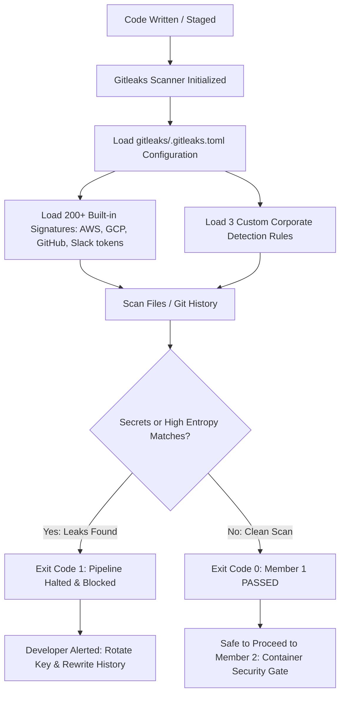

# Member 1 — Secret Security Gate: Complete Architecture & File Breakdown

## Automated Local DevSecOps Pipeline

---

## 1. Executive Summary & Member 1 Responsibility

**Member 1** is responsible for the **first line of defense** in the DevSecOps lifecycle: the **Secret Security Gate**.

```text
[Developer Workspace] ──► [Member 1: Secret Gate] ──► [Member 2: Container Gate] ──► [Member 3: Kubernetes]
                                │
                        (Pass: Exit Code 0)
                        (Fail: Exit Code 1)
```

### The Problem Member 1 Solves:
Developers frequently commit code containing hardcoded credentials such as API keys, database connection strings, JWT tokens, and private SSH keys. Once pushed to Git:
1. **Git retains all historical commits:** Even if a developer deletes the password in the next commit, the credential remains visible in Git commit history forever.
2. **Immediate Exploitation:** Automated malicious bots continuously scrape public repositories for exposed secrets, often exploiting credentials within minutes.

### Member 1's Core Mission:
- Automatically inspect staged files, local working directories, and **the entire Git commit history**.
- Enforce strict detection policies locally and in CI/CD before any code can be packaged or deployed.
- Block the pipeline with **Exit Code `1`** whenever credentials are found, or pass with **Exit Code `0`** when clean.

---

## 2. Architecture & How Member 1 Works



### Detection Mechanisms:
1. **Regex Pattern Matching:** Analyzes syntax looking for assignment patterns like `password = "..."` or `api_key = "..."`.
2. **Shannon Entropy Analysis:** Measures the randomness of characters. Passwords and API tokens have higher entropy (randomness) than plain English words, minimizing false positives while catching obfuscated secrets.
3. **Git Commit Tree Walking:** Gitleaks scans commit blobs, commit messages, and author metadata across all branches (`--fetch-depth: 0`).

---

## 3. Purpose & Breakdown of Each File Created by Member 1

Member 1 designed, implemented, and configured the following repository files:

### 3.1 [`gitleaks/.gitleaks.toml`](../gitleaks/.gitleaks.toml)
* **Role:** Central Detection Rules Engine
* **Purpose:** Defines the exact scanning signatures and policies for Gitleaks.
* **Key Contents & Implementation:**
  - `[extend] useDefault = true`: Automatically inherits Gitleaks' 200+ built-in rules for AWS access keys, GitHub personal access tokens, Google Cloud keys, Slack tokens, private RSA keys, and Stripe keys.
  - **Custom Rule 1 (`generic-password-assignment`):** Detects variables assigned to passwords (`password`, `passwd`, `pwd`) with an entropy threshold of `3.0`.
  - **Custom Rule 2 (`generic-api-key-assignment`):** Catches identifiers containing `api_key`, `api_token`, or `access_token` followed by quoted string assignments.
  - **Custom Rule 3 (`aws-secret-key-assignment`):** Specifically catches AWS secret access key strings.

---

### 3.2 [`test-secrets/clean.env`](../test-secrets/clean.env)
* **Role:** Safe Test Fixture (Verification of PASS Scenario &check;)
* **Purpose:** Proves that the scanner does not produce false positives on standard, non-sensitive configuration keys.
* **Key Contents:**
  - Contains harmless environment settings such as `DATABASE_HOST="postgres-db.internal"`, `DATABASE_PORT="5432"`, `LOG_LEVEL="INFO"`, and `ENABLE_DEBUG="false"`.
  - Used in testing and demonstrations to verify that Gitleaks completes with **Exit Code `0`** and `no leaks found`.

---

### 3.3 [`test-secrets/bad.env`](../test-secrets/bad.env)
* **Role:** Vulnerable Test Fixture (Verification of FAIL Scenario &cross;)
* **Purpose:** Provides safe, simulated mock credentials to prove that Gitleaks' custom and default rules trigger correctly and block the pipeline.
* **Key Contents:**
  - Contains simulated passwords (`DATABASE_PASSWORD="mysecret123"`), fake API keys (`API_KEY="FAKE_API_KEY_123456"`), and demo tokens (`ACCESS_TOKEN="superSecretToken_Demo_NotReal_9999"`).
  - Used in demonstrations to prove that Gitleaks detects 3 leaks and halts with **Exit Code `1`**.

---

### 3.4 [`.github/workflows/reusable-gitleaks.yml`](../.github/workflows/reusable-gitleaks.yml)
* **Role:** Enterprise-Grade Reusable GitHub Actions Workflow
* **Purpose:** Encapsulates the secret scanning logic so that any repository across the organization can call it without duplicating code.
* **Key Features:**
  - Triggered via `workflow_call`.
  - Performs full repository checkout with `fetch-depth: 0` (critical for git history scanning).
  - Auto-resolves the `.gitleaks.toml` configuration file.
  - Executes `gitleaks/gitleaks-action@v2`.
  - Automatically fails the CI/CD job and blocks PR merges if a secret is discovered.

---

### 3.5 [`.github/workflows/secret-scan.yml`](../.github/workflows/secret-scan.yml)
* **Role:** Local Repository Caller Workflow
* **Purpose:** Binds Member 1's secret security gate to every code push and pull request targeted at `main`.
* **Key Features:**
  - Invokes the centralized `reusable-gitleaks.yml` workflow.
  - Ensures continuous automated scanning on GitHub without requiring manual developer action.

---

### 3.6 [`gitleaks/README.md`](../gitleaks/README.md)
* **Role:** Module Technical Reference
* **Purpose:** Explains how to install Gitleaks on local developer machines, how the `.gitleaks.toml` schema is written, how to run ad-hoc scans, and how to export SARIF reports.

---

### 3.7 [`docs/secret-scanning.md`](../docs/secret-scanning.md)
* **Role:** Deep-Dive Threat Model & Compliance Documentation
* **Purpose:** Explains the DevSecOps compliance rationale, entropy mathematics, secret remediation strategies (revocation vs history rewriting with `git-filter-repo`), and the handoff contract to downstream pipeline gates.

---

### 3.8 [`.gitignore`](../.gitignore)
* **Role:** Repository Hygiene & Artifact Exclusion
* **Purpose:** Ensures that scan outputs (`gitleaks-report.json`, `gitleaks-report.sarif`), temporary test caches, and local binary extraction directories (`gitleaks_install/`) are never inadvertently committed into version control.

---

## 4. How to Test Member 1's Work (Step-by-Step)

From your PowerShell terminal at the repository root:

### 1. Test the PASS Scenario (Exit Code 0)
```powershell
gitleaks dir --config gitleaks/.gitleaks.toml --verbose test-secrets/clean.env; echo "Exit Code: $LASTEXITCODE"
```
* **Result:** `INF no leaks found`, `Exit Code: 0`.

### 2. Test the FAIL Scenario (Exit Code 1)
```powershell
gitleaks dir --config gitleaks/.gitleaks.toml --verbose test-secrets/bad.env; echo "Exit Code: $LASTEXITCODE"
```
* **Result:** `WRN leaks found: 3`, `Exit Code: 1`.

---

## 5. Handoff Contract to Member 2

When Member 1's scan passes with **Exit Code `0`**, the codebase is verified free of plaintext secrets. The artifact is then approved for packaging by **Member 2 (Docker + Aqua Trivy Container Security Gate)**.
