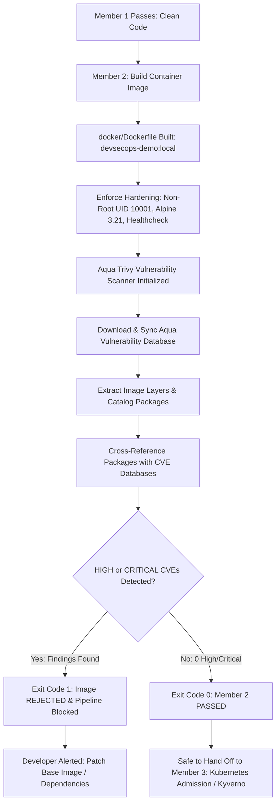

# Member 2 — Container Security Gate: Complete Architecture & File Breakdown

## Automated Local DevSecOps Pipeline

---

## 1. Executive Summary & Member 2 Responsibility

**Member 2** is responsible for the **second security gate** in the DevSecOps lifecycle: the **Container Security Gate (Docker + Aqua Trivy)**.

```text
[Member 1: Secret Gate] ──► [Member 2: Container Gate] ──► [Member 3: Kubernetes] ──► [Member 4: Pipeline]
       (Passed)                         │
                                (Pass: Exit Code 0)
                                (Fail: Exit Code 1)
```

### The Problem Member 2 Solves:
Even if source code contains zero plaintext secrets and zero application bugs, packaging that code into a Docker container introduces:
1. **Operating System Vulnerabilities (CVEs):** Base images often bundle unpatched system packages (`musl`, `libcrypto`, `openssl`, `busybox`, `sqlite`) that contain critical vulnerabilities (e.g. Remote Code Execution, buffer overflows).
2. **Container Privilege Escalation:** Containers running as `root` (UID 0) expose the host machine to container breakout attacks if the process is compromised.
3. **Bloated Attack Surface:** Large container images (e.g., standard Ubuntu or full Debian) include package managers, compilers, and shells that attackers can leverage.

### Member 2's Core Mission:
- Build a hardened, minimal, unprivileged container image adhering to production DevSecOps best practices.
- Implement automated vulnerability scanning using **Aqua Security Trivy** to scan image layers for known Common Vulnerabilities and Exposures (CVEs).
- Enforce strict security policy: Block the pipeline with **Exit Code `1`** if any **HIGH or CRITICAL** CVEs exist; allow passage with **Exit Code `0`** only when clean.

---

## 2. Architecture & How Member 2 Works



### How Aqua Trivy Analyzes Container Images:
1. **Layer Extraction:** Trivy examines each filesystem layer in the image to locate installed package manifests (Alpine `apk` database, Debian `dpkg`, Python `pip` packages).
2. **Upstream Advisory Matching:** Cross-references installed package versions against hourly updated vulnerability feeds:
   - National Vulnerability Database (NVD / NIST)
   - Alpine Security Database (SecDB)
   - Debian Security Bug Tracker & Red Hat OVAL
   - GitHub Advisory Database
3. **CVSS Severity Enforcement:** Evaluates Common Vulnerability Scoring System (CVSS) metrics. If any detected CVE equals or exceeds the threshold (`HIGH` or `CRITICAL`), the scan halts immediately with **Exit Code `1`**.

---

## 3. Purpose & Breakdown of Each File Created by Member 2

Member 2 designed, implemented, and configured the following files:

### 3.1 [`docker/Dockerfile`](../docker/Dockerfile)
* **Role:** Hardened Container Image Specification
* **Purpose:** Builds the application into a secure, minimal container image while eliminating common container security risks.
* **Key Implementation & Hardening Controls:**
  - **Pinned Base Image:** Uses `python:3.12.9-alpine3.21` (not floating `:latest`), ensuring reproducible builds and a tiny attack surface (~17 MB).
  - **Unprivileged User (`Non-Root`):** Creates an explicit group and user (`appuser` with UID `10001`) and declares `USER 10001:10001`. The container never executes as `root`.
  - **Scoped Directory:** Establishes `WORKDIR /app` and copies only `app.py` with ownership `--chown=appuser:appgroup`.
  - **Built-In Healthcheck:** Declares `HEALTHCHECK --interval=30s --timeout=5s --retries=3` so container orchestrators can monitor service readiness natively without external agents.

---

### 3.2 [`docker/app.py`](../docker/app.py)
* **Role:** Sample Python Microservice
* **Purpose:** Serves as the lightweight application payload to demonstrate containerization and security validation.
* **Key Implementation:**
  - Built using Python's native standard library (`http.server`) with **zero external dependencies** (`pip` packages), eliminating third-party supply chain risks.
  - Exposes `GET /` and `GET /status`.
  - The `/status` endpoint inspects its own runtime environment and returns a JSON payload proving it runs non-root (`"non_root": true`, `"status": "healthy"`).

---

### 3.3 [`docker/.dockerignore`](../docker/.dockerignore) & [`.dockerignore`](../.dockerignore)
* **Role:** Build-Context Security Boundary
* **Purpose:** Blocks sensitive, unnecessary, and development files from entering the Docker build context.
* **Key Exclusions:**
  - Excludes `.git/` (protects entire Git commit history from leaking into the container image).
  - Excludes `test-secrets/` and `*.env` (guarantees Member 1 test secrets never enter the runtime image).
  - Excludes local scan reports (`*.json`, `*.sarif`) and temporary caches.

---

### 3.4 [`trivy/trivy.yaml`](../trivy/trivy.yaml)
* **Role:** Declarative Trivy Configuration File
* **Purpose:** Standardizes scanning policies so that local CLI scans and CI/CD pipelines enforce identical security rules.
* **Key Configuration Directives:**
  - `scan-type: "image"`: Targets container images.
  - `severity: "HIGH,CRITICAL"`: Filters out low/medium noise to focus exclusively on actionable, severe vulnerabilities.
  - `exit-code: 1`: Enforces pipeline failure if any violation is detected.
  - `format: "table"`: Formats human-readable findings in terminal outputs.

---

### 3.5 [`trivy/README.md`](../trivy/README.md)
* **Role:** Module Technical Reference
* **Purpose:** In-depth guide explaining how Aqua Trivy works, how the vulnerability database updates, how to run scans via Docker or native Windows binaries, and how to interpret CVE vulnerability reports.

---

### 3.6 [`.github/workflows/container-security.yml`](../.github/workflows/container-security.yml)
* **Role:** Automated Container Security CI/CD Pipeline
* **Purpose:** Automatically triggers whenever changes are made to container assets (`docker/**`, `trivy/**`, or the workflow itself).
* **Key Pipeline Steps:**
  1. Checks out the repository.
  2. Sets up Docker Buildx.
  3. Builds the container image `devsecops-demo:${{ github.sha }}`.
  4. Runs `aquasecurity/trivy-action` enforcing severity threshold `HIGH,CRITICAL` and `exit-code: '1'`.
  5. Publishes a SARIF report to GitHub Security if vulnerabilities are found.

---

### 3.7 [`docs/container-security.md`](../docs/container-security.md)
* **Role:** Threat Model & Hardening Architecture Document
* **Purpose:** Detailed theoretical and architectural documentation covering container attack surfaces, base image selection rationale, least-privilege principles, and handoff contracts to Member 3.

---

## 4. How to Test Member 2's Work (Step-by-Step)

From your PowerShell terminal at the repository root:

### Step 1: Build the Container Image
```powershell
docker build -t devsecops-demo:local -f docker/Dockerfile .
```

### Step 2: Test Functional Healthcheck
```powershell
docker run -d --rm -p 8080:8080 --name test-demo devsecops-demo:local
Invoke-RestMethod -Uri http://localhost:8080/status | ConvertTo-Json
docker stop test-demo
```
* **Result:** `"status": "healthy"`, `"non_root": true`.

### Step 3: Test the PASS Scenario (Exit Code 0)
Scan the hardened production image:
```powershell
docker run --rm -v /var/run/docker.sock:/var/run/docker.sock aquasec/trivy:latest image --severity HIGH,CRITICAL --exit-code 1 devsecops-demo:local; echo "Security Gate Exit Code: $LASTEXITCODE"
```
* **Result:** `Total: 0 (HIGH: 0, CRITICAL: 0)`, `Security Gate Exit Code: 0`.

### Step 4: Test the FAIL Scenario (Exit Code 1)
Scan a vulnerable legacy container (`python:3.8-slim-buster`) to prove Trivy detects CVEs:
```powershell
docker run --rm -v /var/run/docker.sock:/var/run/docker.sock aquasec/trivy:latest image --severity HIGH,CRITICAL --exit-code 1 python:3.8-slim-buster; echo "Security Gate Exit Code: $LASTEXITCODE"
```
* **Result:** `Total: 4 (HIGH: 4, CRITICAL: 0)`, `Security Gate Exit Code: 1`.

---

## 5. Handoff Contract to Member 3

When Member 2's container scan passes with **Exit Code `0`**, the image is certified:
1. Free of high or critical CVE vulnerabilities.
2. Built with unprivileged user enforcement (`UID 10001`).
3. Accompanied by a verified `/status` healthcheck.

The image is now officially approved for **Member 3: Kubernetes Cluster Admission & Kyverno Policy Enforcement**.
