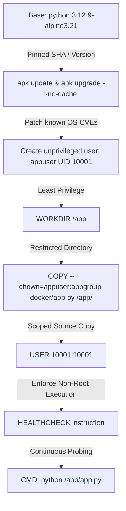

# Container Security with Docker & Trivy — Extended Documentation

## DevSecOps Mini-Project — Member 2 Module

---

## 1. Overview & Objectives

This document provides in-depth technical documentation for the **Container Security Gate** built using **Docker** and **Aqua Security Trivy**. It supplements `trivy/README.md` and explains the threat model, Dockerfile hardening choices, Trivy vulnerability database architecture, CI/CD pipeline integration, and handoff contracts for Member 3 (Kubernetes / Kyverno) and Member 4 (CI/CD Orchestration).

The primary objective of Member 2 is to prevent vulnerable, bloated, or misconfigured container images from advancing into orchestration clusters or production environments.

---

## 2. Threat Model & Container Attack Surface

When code is packaged into a container image, vulnerabilities can enter through three distinct layers:

| Container Layer | Vulnerability Source | Example Threat | Mitigation Applied in Member 2 |
| :--- | :--- | :--- | :--- |
| **Operating System** | Outdated base distribution packages (`musl`, `openssl`, `busybox`, `sqlite`) | Remote Code Execution (RCE), denial of service, memory corruption | Pinned `python:3.12.9-alpine3.21` + `apk upgrade --no-cache` to apply latest security patches |
| **Language Dependencies** | Outdated or malicious packages in `pip`, `npm`, `gems` | Supply chain attacks, dependency confusion, known CVEs in libraries | Minimal application with standard library only; scanned by Trivy |
| **Container Runtime / Config** | Running as root, missing healthcheck, exposed secrets | Container breakout, root privilege escalation on host node | Non-root `appuser` (UID 10001), healthcheck directive, `.dockerignore` blocking secrets |

---

## 3. Docker Hardening Architecture

The sample microservice in [`docker/Dockerfile`](file:///docker/Dockerfile) implements the following hardening controls:



### Why Alpine Linux?
- **Minimal attack surface**: Standard Ubuntu images weigh 70–120 MB and ship hundreds of utility binaries (compilers, interpreters, networking tools). The Alpine base used here is ~17 MB and contains only essential system libraries.
- **Security-focused libc**: Alpine uses `musl libc` and stack-smashing protection (`-fstack-protector-strong`) by default.
- **Fast CI/CD execution**: Layer pulls and Trivy scans execute significantly faster due to the reduced package count (only 37 packages).

---

## 4. Trivy Architecture & Vulnerability Detection

### 4.1 Vulnerability Database (Trivy DB)
Aqua Security maintains an open-source, automated database (`trivy-db`) aggregated from:
- **Alpine SecDB** (Alpine Linux security advisories)
- **NVD** (National Vulnerability Database / NIST)
- **GitHub Advisory Database**
- **CWE / CVSS** vulnerability scoring feeds

Trivy downloads this database at scan time, compares the cryptographic package hashes and package versions installed in the container against published CVE advisories, and generates vulnerability records.

### 4.2 Severity Threshold Policy
The container security gate strictly enforces:
```text
--severity HIGH,CRITICAL --exit-code 1
```
- **Exit Code 0 (PASS)**: The image contains zero HIGH or CRITICAL severity vulnerabilities. Low and Medium findings may be reported for auditing but do not break builds.
- **Exit Code 1 (FAIL)**: One or more HIGH or CRITICAL vulnerabilities exist. The security gate halts the pipeline immediately.
- **Exit Code 2 (ERROR)**: Scanner execution failure (e.g. network failure downloading DB, invalid Docker socket, corrupted image). Prevents silent bypass.

---

## 5. Local Execution Guide (Windows PowerShell)

All commands should be executed from the repository root:

### 5.1 Build the Image
```powershell
docker build -t devsecops-demo:local -f docker/Dockerfile .
```

### 5.2 Test Healthy Execution & Non-Root User
```powershell
# Run container in background
docker run -d --rm -p 8080:8080 --name demo-app devsecops-demo:local

# Verify health endpoint and non-root status
Invoke-RestMethod -Uri http://localhost:8080/status | ConvertTo-Json

# Stop container
docker stop demo-app
```

### 5.3 Run Trivy Vulnerability Scan (Security Gate)
```powershell
# Using official Trivy container (recommended)
docker run --rm -v /var/run/docker.sock:/var/run/docker.sock `
  aquasec/trivy:latest image `
  --severity HIGH,CRITICAL `
  --exit-code 1 `
  devsecops-demo:local

echo "Security Gate Exit Code: $LASTEXITCODE"
```

### 5.4 Export JSON Report
```powershell
docker run --rm -v /var/run/docker.sock:/var/run/docker.sock `
  aquasec/trivy:latest image `
  --severity HIGH,CRITICAL `
  --format json `
  devsecops-demo:local | Out-File -Encoding utf8 trivy-report.json
```

---

## 6. Integration Contract: Member 1 → Member 2 → Member 3 & 4

### Upstream Dependency (Member 1: Gitleaks)
- Member 2 **only builds and scans images after Member 1's secret scan passes**.
- If Member 1 discovers committed secrets or API keys, the pipeline halts immediately with Exit Code 1.
- Docker build context strictly excludes any credential files (`test-secrets/`, `*.env`) via `.dockerignore`.

### Downstream Handoff (Member 3: Kubernetes & Kyverno)
- Once Trivy validates that `devsecops-demo:local` has 0 HIGH/CRITICAL CVEs, Member 3 can deploy the image to a local **Minikube** cluster.
- Member 3's Kyverno admission controller verifies runtime policies:
  - Disallow running as root (`runAsNonRoot: true`)
  - Disallow privileged containers
  - Require read-only root filesystems where applicable

### CI/CD Orchestration (Member 4)
- Member 4 orchestrates the consolidated GitHub Actions pipeline combining:
  1. `secret-scan` (Member 1)
  2. `container-security` (Member 2)
  3. `k8s-policy-test` (Member 3)
  4. Alert notifications (Slack/Discord Webhooks)
